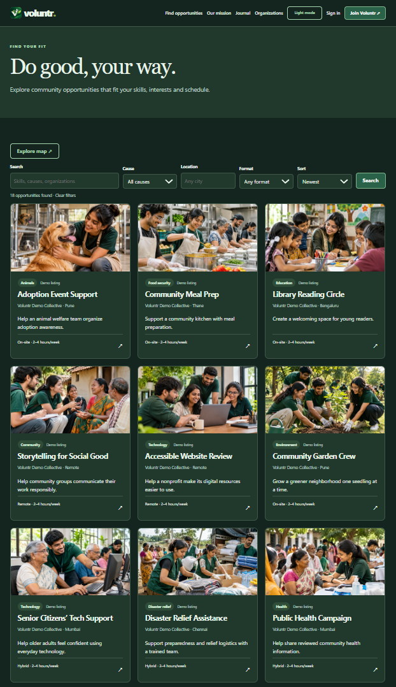

# Voluntr

A Django-powered community volunteering platform connecting people with meaningful opportunities and helping organizers coordinate contributions.

**Live demo:** https://voluntr.onrender.com

## Interface previews

Static design previews, not screenshots of a running Django server.

[Homepage preview](docs/home-preview.html) · [Opportunity explorer preview](docs/explore-preview.html)

## Features

- Opportunity discovery, search, filters and pagination
- Volunteer and organizer accounts with role-specific dashboards
- Profile-based matching, bookmarks and application tracking
- Moderated organizer submissions and application review
- Volunteer hour submission and approval
- Journal, contact and newsletter interest forms
- Django administration and public read-only opportunities API

## Stack

Django, Python, HTML, CSS, JavaScript, SQLite / PostgreSQL, Gunicorn and WhiteNoise.

Demo listings are fictional examples. Photography consists of 15 independent AI-generated illustrative scenes (1672 × 941 pixels), not photographs of actual Voluntr events. Other listings and journal stories have individual scalable SVG editorial covers. No photo is cropped from a website mockup. The previews below are static interface previews, not live server screenshots.

## Visual previews

## Additional capabilities

- Application activity overview and journal search by topic or keyword
- Listing reports and administrator moderation queue
- Printable contribution records based on approved volunteer hours
- Organizer-only application CSV exports
- Password recovery (SMTP configuration required for production email delivery)
- Custom error pages and automatic demo data initialization on deployment

