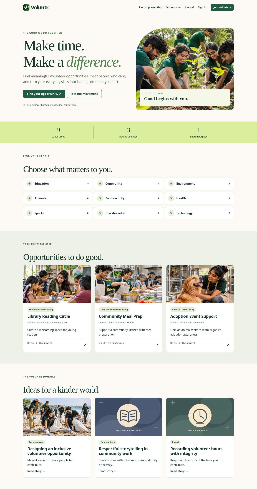
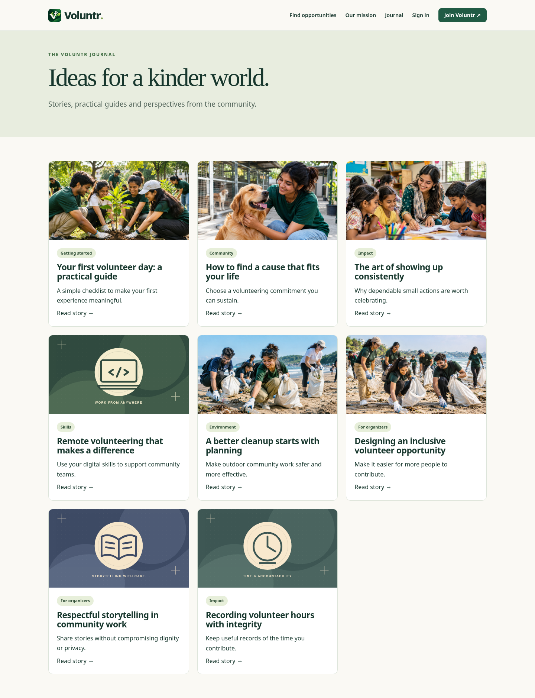

# Voluntr

A Django-powered community volunteering platform connecting people with meaningful opportunities and helping organizers coordinate contributions.

**Live demo:** https://voluntr.onrender.com

## Interface previews

Static design previews, not screenshots of a running Django server.

[Homepage preview](docs/home-preview.html) · [Opportunity explorer preview](docs/explore-preview.html)

## Features

- Opportunity discovery, search, filters and pagination
- Volunteer and organizer accounts with role-specific dashboards
- Profile-based matching, bookmarks and application tracking
- Moderated organizer submissions and application review
- Volunteer hour submission and approval
- Journal, contact and newsletter interest forms
- Django administration and public read-only opportunities API

## Stack

Django, Python, HTML, CSS, JavaScript, SQLite / PostgreSQL, Gunicorn and WhiteNoise.

Demo listings are fictional examples. Photography consists of 15 independent AI-generated illustrative scenes (1672 × 941 pixels), not photographs of actual Voluntr events. Other listings and journal stories have individual scalable SVG editorial covers. No photo is cropped from a website mockup. The previews below are static interface previews, not live server screenshots.

## Visual previews




## Additional capabilities

- Application activity overview and journal search by topic or keyword
- Listing reports and administrator moderation queue
- Printable contribution records based on approved volunteer hours
- Organizer-only application CSV exports
- Password recovery and email verification (Brevo HTTPS API or SMTP)
- Custom error pages and automatic demo data initialization on deployment



## Configuration (environment variables)

| Variable | Purpose |
| --- | --- |
| `SECRET_KEY` | Required in production. |
| `DEBUG` | `0` in production. |
| `DATABASE_URL` | PostgreSQL connection string (Neon). |
| `ALLOWED_HOSTS`, `CSRF_TRUSTED_ORIGINS` | Extra hosts; the Render hostname is added automatically. |
| `PUBLIC_BASE_URL` | e.g. `https://voluntr.onrender.com` — used for links in emails. |
| `BREVO_API_KEY` | **Recommended.** Sends email through Brevo's HTTPS API (Render's free plan blocks SMTP ports). |
| `DEFAULT_FROM_EMAIL` | e.g. `Voluntr <hello@yourdomain.com>` — must be a sender verified in Brevo. |
| `EMAIL_HOST`, `EMAIL_PORT`, `EMAIL_HOST_USER`, `EMAIL_HOST_PASSWORD` | SMTP fallback (only if `BREVO_API_KEY` is not set). |
| `SEED_DEMO_ON_MIGRATE` | Default `1`. Sample listings, journal stories and organizations are created automatically after `migrate` (create-only, never overwrites edits). Set `0` to disable. |
| `REQUIRE_EMAIL_VERIFICATION` | Default `1`. Set `0` to temporarily let unverified users apply/post/message. |
| `GOOGLE_CLIENT_ID`, `GOOGLE_CLIENT_SECRET`, `GOOGLE_REDIRECT_URI` | Google sign-in. Redirect URI: `https://voluntr.onrender.com/community/google/callback/`. |

## Running locally

```bash
python -m venv .venv && .venv\Scripts\activate   # Windows
pip install -r requirements.txt
python manage.py migrate
python manage.py seed_demo          # sample listings, journal and organizations (add --refresh to overwrite edits)
python manage.py runserver
python manage.py test               # includes core/test_checklist.py, a walkthrough of the QA checklist
```

Event reminders: run `python manage.py send_event_reminders` hourly (e.g. a Render Cron Job).
